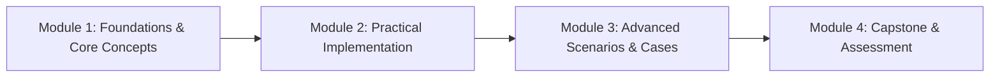

# Syllabus & Curriculum Module Structure — {{PROJECT_NAME}}

> Canonical document establishing the learning syllabus, modular progressive curriculum structure, learner prerequisites, and intended learning outcomes for `{{PROJECT_NAME}}`.

---

## 1. Education & Training Program Profile

| Parameter | Value |
|---|---|
| **Training Format & Model** | `{{TRAINING_TYPE}}` |
| **Target Learner Profile** | `{{TARGET_LEARNER}}` |
| **Curriculum Scope** | `{{CURRICULUM_SCOPE}}` |
| **Primary Assessment Method** | `{{ASSESSMENT_METHOD}}` |
| **Curriculum Decision Authority** | `{{DECISION_OWNER}}` |

---

## 2. Program Learning Outcomes (PLOs)

Upon completing `{{PROJECT_NAME}}`, learners are expected to demonstrate mastery across:
1. **Cognitive Domain:** Articulate foundational theories, architectural principles, and core vocabulary within `{{CURRICULUM_SCOPE}}`.
2. **Practical Domain:** Independently operate workflows, toolchains, and industry-standard tooling to resolve real-world challenges.
3. **Synthesis & Problem Solving:** Diagnose failures, systematically debug anomalies, and formulate data-driven optimizations.

---

## 3. Learner Prerequisites & Baseline Requirements

Prior to admission, learners must meet the following entry criteria:
- **Foundational Background:** *(e.g., Basic computational thinking / familiarity with business domain concepts)*.
- **Environment & Hardware:** *(e.g., Laptop with minimum 8GB RAM, stable high-speed internet, administrative installation privileges)*.
- **Diagnostic Pre-Assessment:** *(Completion of intake survey or placement diagnostic to calibrate instruction)*.

---

## 4. Modular Curriculum Structure & Detailed Syllabus

The curriculum is structured into 4 sequential modules:

| Module | Module Name | Duration | Session Objective | Key Topics Covered | Participant Deliverable |
|---|---|---|---|---|---|
| **Module 1** | Foundations & Concepts | *(X hrs / sessions)* | Master foundational models and structural terminology | Core terminology, conceptual paradigms, system overview | Concept comprehension worksheet |
| **Module 2** | Practical Implementation | *(X hrs / sessions)* | Hands-on workflow execution and tool fluency | Guided labs, standard procedures, guided case walk | Completed practical exercise lab |
| **Module 3** | Advanced Scenarios | *(X hrs / sessions)* | Resolve edge cases and complex real-world dynamics | Industry case breakdowns, anomaly handling, optimizations | Complex scenario analysis report |
| **Module 4** | Capstone Project | *(X hrs / sessions)* | Synthesize comprehensive skills into an autonomous build | Autonomous project build, oral walkthrough, peer Q&A | Production-ready capstone portfolio |

---

## 5. Dependency Mapping & Instructional Hours

- **Total Instructional Volume:** *(e.g., 32 Instructional Hours / 4 Intensive Weeks)*.
- **Allocation Ratio:**
  - 30% Interactive conceptual lecture & foundational demonstration.
  - 50% Hands-on lab execution & practical project work.
  - 20% Evaluation, capstone review, and continuous feedback.
