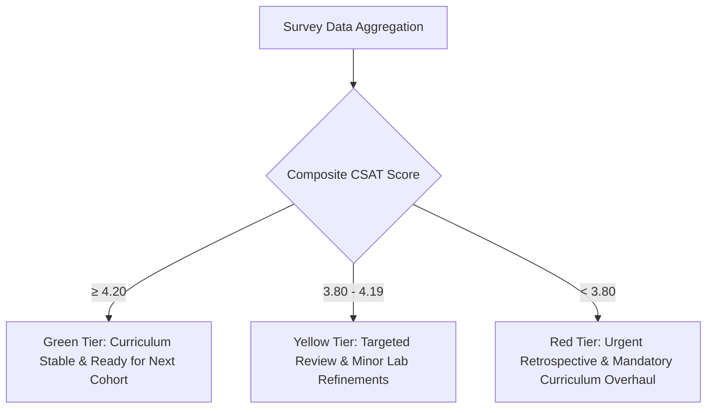

# Participant Feedback & Continuous Improvement — {{PROJECT_NAME}}

> Canonical document establishing post-program learner satisfaction surveys, analytical quality thresholds, corrective action triggers, and curriculum iteration loops for `{{PROJECT_NAME}}`.

---

## 1. Quality Assurance Governance

| Parameter | Value |
|---|---|
| **Evaluation Channel** | Anonymous Electronic Post-Program Survey |
| **Target Audience** | `{{TARGET_LEARNER}}` |
| **Target CSAT Benchmark** | Mean composite score ≥ 4.20 / 5.00 (or ≥ 85%) |
| **Academic Quality Lead** | `{{DECISION_OWNER}}` |

---

## 2. Learner Satisfaction Survey Instrument (1–5 Likert Scale)

Surveys are administered digitally prior to the conclusion of the final session:

| Evaluation Dimension | Survey Statement | Scale (1–5) | Target Benchmark |
|---|---|---|---|
| **Curriculum Relevance** | 1. Course content aligns directly with my practical work requirements. | [ ] | ≥ 4.2 |
| | 2. Syllabus structure and module progression were logically sequenced. | [ ] | ≥ 4.0 |
| **Instructor Performance** | 3. The instructor demonstrated subject matter expertise and clarity. | [ ] | ≥ 4.3 |
| | 4. The instructor was engaging, approachable, and responsive to questions. | [ ] | ≥ 4.3 |
| **Labs & Materials** | 5. Practical hands-on exercises reinforced conceptual understanding. | [ ] | ≥ 4.2 |
| | 6. Course slides and reference guides were effective for self-study. | [ ] | ≥ 4.0 |
| **Platform & Logistics** | 7. Learning environment / virtual platform was reliable and accessible. | [ ] | ≥ 4.0 |
| | 8. Operational coordination and technical support were prompt and helpful. | [ ] | ≥ 4.1 |

> **Rating Scale:** 1 = Very Dissatisfied | 2 = Dissatisfied | 3 = Neutral | 4 = Satisfied | 5 = Very Satisfied

---

## 3. Qualitative Open-Ended Inquiries

1. Which specific topic or exercise yielded the greatest professional value for you?
   > *(Participant open-text response)*
2. Which module or concept was most difficult to grasp or requires additional instructional time?
   > *(Participant open-text response)*
3. What concrete enhancement would you recommend for future iterations of this program?
   > *(Participant open-text response)*

---

## 4. Analytical Thresholds & Corrective Action Triggers

- **Net Promoter Score (NPS):** "How likely are you to recommend this program to a colleague?" (0–10 scale). Target NPS ≥ +40.
- **Reporting SLA:** The comprehensive cohort debrief report must be compiled within 3 business days post-program and delivered to `{{DECISION_OWNER}}`.

---

## 5. Iterative Curriculum Improvement Lifecycle

Curriculum refinements follow a systematic cross-cohort lifecycle:

1. **Post-Cohort Retrospective (D+5):** Joint review session with instructors, instructional designers, and learner representatives.
2. **Material Optimization (D+14):** Revise slides, clarify ambiguous lab prompts, and refresh training data or dependencies.
3. **Pre-Launch Validation (D+21):** Perform dry run of updated materials prior to rollout in the subsequent cohort.
