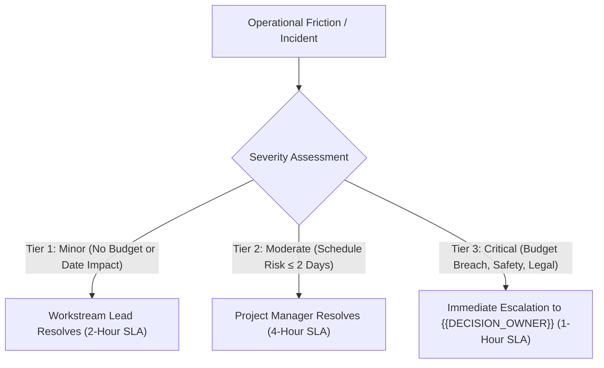

# Stakeholder Mapping & RACI Responsibility Matrix — {{PROJECT_NAME}}

> Canonical document establishing key stakeholder governance, RACI responsibility definitions, operational communications cadences, and decision escalation protocols for `{{PROJECT_NAME}}`.

---

## 1. Governance & Leadership Architecture

| Parameter | Value |
|---|---|
| **Stakeholder Mapping Strategy** | `{{STAKEHOLDER_MAP}}` |
| **Project Sponsor / Executive Lead** | `{{DECISION_OWNER}}` |
| **Project Type** | `{{PROJECT_TYPE}}` |
| **Accountability Rule** | Exactly one single accountable authority designated per deliverable |

---

## 2. Key Stakeholder Landscape

| Role | Key Stakeholders | Core Strategic Interests | Influence Tier |
|---|---|---|---|
| **Project Sponsor** | `{{DECISION_OWNER}}` | Strategic milestone delivery, financial compliance, brand equity | Highest Tier |
| **Project Manager** | PM Leadership Team | Cross-stream execution, timeline preservation, blocker resolution | High Tier |
| **Creative & Programming** | Content & Experience Team | Program agenda quality, speaker engagement, aesthetic resonance | High Tier |
| **Logistics & Facilities** | Operations & Venue Leads | Venue infrastructure, technical reliability, safety, catering | High Tier |
| **External Partners** | Vendors, Sponsors, Regulators | Contractual SLA adherence, public compliance, brand alignment | Medium – High |

---

## 3. Cross-Workstream RACI Matrix

> **RACI Responsibility Framework:**
> **R (Responsible):** The execution lead tasked with direct implementation.
> **A (Accountable):** The ultimate decision authority holding sign-off power.
> **C (Consulted):** Subject matter advisors providing input prior to decisions.
> **I (Informed):** Stakeholders updated on progress and final outcomes.

| Key Workstream / Deliverable | Project Sponsor | Project Manager | Event Program | Operations / Logistics | Marketing & Comm |
|---|---|---|---|---|---|
| **Concept, Agenda, & Keynote Speakers** | **A** | **C** | **R** | **I** | **C** |
| **Budget Allocations & Vendor Contracts** | **A** | **R** | **C** | **C** | **I** |
| **Venue Permitting, Audio-Visual, Safety** | **I** | **A** | **I** | **R** | **I** |
| **Participant Registration & Promotion** | **I** | **A** | **C** | **I** | **R** |
| **Live Stage Execution & Rehearsals (D-Day)** | **I** | **A** | **R** | **R** | **I** |
| **Post-Event Audit & Final Debrief (LPJ)** | **A** | **R** | **C** | **C** | **C** |

---

## 4. Operational Communications Cadence

1. **Sprint Planning & Weekly Sync:** Weekly 45-minute progress session auditing cross-functional milestone burn-down.
2. **Daily Standup (D-7 through Launch):** Focused 15-minute morning check-in auditing tactical readiness and blockers.
3. **War Room & Command Center (Live Day):** Central coordination bridge backed by dedicated radio comms and real-time chat.

---

## 5. Decision & Issue Escalation Matrix

When project schedule slippages, financial deviations, or operational emergencies emerge:

