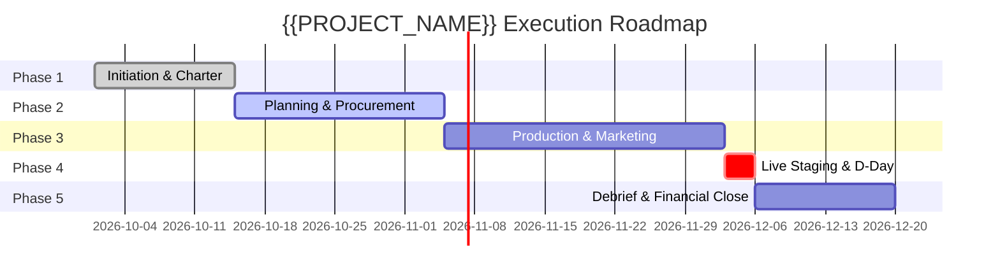

# Milestone Timeline & Financial Budget Plan — {{PROJECT_NAME}}

> Canonical document establishing the sequential milestone roadmap, cost expenditure allocations, financial variance tracking, and change request procedures for `{{PROJECT_NAME}}`.

---

## 1. Timeline & Financial Baseline

| Parameter | Value |
|---|---|
| **Project Horizon** | `{{TIMELINE_HORIZON}}` |
| **Project Category** | `{{PROJECT_TYPE}}` |
| **Contingency Buffer Reserve** | 10% – 15% of total approved financial allocation |
| **Financial Approval Authority** | `{{DECISION_OWNER}}` |

---

## 2. Project Milestone Roadmap

The initiative advances through 5 gated phases:

| Project Phase | Milestone Focus | Target Date | Gate Criteria (Deliverable Output) | Status |
|---|---|---|---|---|
| **Phase 1: Initiation** | Formalize charter and secure core team commitments | `YYYY-MM-DD` | Project charter signed by `{{DECISION_OWNER}}` | [ ] Complete |
| **Phase 2: Planning** | Secure venue master contract, primary vendors, & permits | `YYYY-MM-DD` | Vendor contracts executed; legal permits active | [ ] In Progress |
| **Phase 3: Production** | Participant registration campaign & technical runs | `YYYY-MM-DD` | 100% registration capacity achieved; staging ready | [ ] Pending |
| **Phase 4: Execution** | Technical rehearsals and live event staging | `YYYY-MM-DD` | All scheduled programming executed safely | [ ] Pending |
| **Phase 5: Closeout** | Financial reconciliation, CSAT debrief, & final report | `YYYY-MM-DD` | Audit report and financial close signed off | [ ] Pending |

---

## 3. Financial Budget Allocations

| Cost Center / Item | Functional Description | Allocated Budget | Actual Spend | Variance (%) | Health |
|---|---|---|---|---|---|
| **1. Venue & Facilities** | Facility lease, stage construction, audio-visual, lighting | [Budget] | [Actual] | [ % ] | On Track |
| **2. Production & Creative** | Brand identity, stage backdrops, badge credentials, media | [Budget] | [Actual] | [ % ] | On Track |
| **3. Catering & Hospitality** | Attendee catering, beverage stations, VIP greenrooms | [Budget] | [Actual] | [ % ] | On Track |
| **4. Marketing & Acquisition** | Paid campaigns, creative assets, public relations | [Budget] | [Actual] | [ % ] | On Track |
| **5. Operations & Safety** | On-site crew honoraria, emergency medical, municipal police | [Budget] | [Actual] | [ % ] | On Track |
| **6. Contingency Buffer (10%)** | Emergency risk fund for unforeseen operational needs | [Budget] | [Actual] | [ % ] | Allocated |
| **Total Expenditure** | | **[Total]** | **[Total]** | **[ % ]** | |

---

## 4. Change Request Procedure (CR SOP)

When schedule shifts, scope additions, or financial adjustments occur:
1. **Change Request Formulation:** Document the proposed shift, root cause, and downstream impact analysis.
2. **Impact Assessment:** Project Management calculates net effects on final milestones and gross margins.
3. **Formal Endorsement:** Scope or budget changes take legal effect solely upon written sign-off from `{{DECISION_OWNER}}`.
