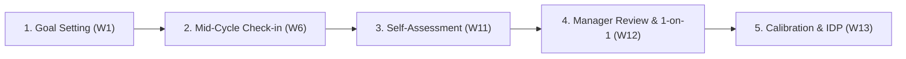

# Performance Review Cycle & Competency Matrix — {{PROJECT_NAME}}

> Canonical document establishing the recurring performance evaluation cycle, role-based competency matrix, assessment rubric, and 1-on-1 review guidelines for `{{PROJECT_NAME}}`.

---

## 1. Performance System Configuration

| Parameter | Value |
|---|---|
| **Performance Review Cadence** | `{{PERFORMANCE_CYCLE}}` |
| **Organizational Scale** | `{{EMPLOYEE_SCALE}}` |
| **Calibration & Decision Lead** | `{{DECISION_OWNER}}` |
| **Evaluation Framework** | Integrated OKRs / KPIs (Deliverables) & Behavioral Competency Evaluation |

---

## 2. Review Cycle Calendar & Flow

Each `{{PERFORMANCE_CYCLE}}` cycle executes across 5 sequential phases:

| Phase | Core Activity | Owner | Required Output |
|---|---|---|---|
| **1. Goal Setting** | Define individual OKRs/KPIs aligned to `{{PROJECT_NAME}}` organizational goals | Employee & Direct Manager | Approved goal sheet |
| **2. Mid-Cycle Check-in** | Assess mid-period progress, eliminate roadblocks, adjust milestones if required | Employee & Direct Manager | Mid-term progress & mitigation log |
| **3. Self-Assessment** | Employee self-evaluation across key results and core competencies | Employee | Submitted self-review form |
| **4. Manager Review & 1-on-1** | Manager evaluation scoring and structured face-to-face feedback dialog | Employee & Direct Manager | Completed manager evaluation sheet |
| **5. Calibration & IDP** | Cross-departmental score calibration and Individual Development Plan creation | Calibration Committee & HR | Calibrated final score & IDP document |

---

## 3. Role Competency Matrix

The following matrix establishes behavioral and craft expectations across organizational seniority levels:

| Seniority Level | Execution & Technical Craft | Problem Solving & Initiative | Communication & Collaboration | Leadership & Influence |
|---|---|---|---|---|
| **Junior / Associate** | Executes defined tasks with regular guidance; high output accuracy | Identifies operational issues promptly and reports with proposed fixes | Communicates transparently; receptive to constructive feedback | Manages personal time and responsibilities reliably |
| **Mid-Level** | Drives end-to-end tasks within module scope independently; maintains quality | Resolves routine ambiguity autonomously; optimizes workflows | Collaborates cross-functionally; documents workflows for team reuse | Mentors junior teammates; shares knowledge actively |
| **Senior** | Architects solutions for complex domains; anticipates edge cases | Performs rigorous root cause analysis; implements resilient systems | Delivers compelling stakeholder presentations; resolves misalignment | Champions engineering/operational best practices; guides team |
| **Lead / Manager** | Shapes domain roadmaps; aligns technical strategy with business vision | Makes high-stakes decisions under uncertainty; balances trade-offs | Executive alignment and crisis communication stewardship | Develops team talent; sponsors growth paths for direct reports |

---

## 4. Performance Assessment Form

The composite evaluation score combines Deliverable Output (60%) and Behavioral Competencies (40%):

### 4.1. Section A: OKR / KPI Achievements (Weight: 60%)
| No | Objective / Key Result | Target Metric | Actual Result | Achievement (%) | Weighted Score |
|---|---|---|---|---|---|
| 1 | *(Primary Objective 1)* | *(Number / Percentage)* | *(Actual delivery)* | *(% attained)* | [ ] |
| 2 | *(Primary Objective 2)* | *(Number / Percentage)* | *(Actual delivery)* | *(% attained)* | [ ] |
| 3 | *(Supporting Objective 3)* | *(Number / Percentage)* | *(Actual delivery)* | *(% attained)* | [ ] |
| **Section A Subtotal** | | | | | **[Score A]** |

### 4.2. Section B: Behavioral Competencies & Values (Weight: 40%)
| No | Competency Dimension | Behavioral Indicator | Score (1–5) | Demonstrated Evidence |
|---|---|---|---|---|
| 1 | Craft Quality & Reliability | Consistent defect-free output delivered on schedule | [ ] | *(Concrete work examples)* |
| 2 | Cross-Team Collaboration | Supports peers and fosters alignment across workflows | [ ] | *(Concrete work examples)* |
| 3 | Ownership & Integrity | Takes full accountability for outcomes and ethics | [ ] | *(Concrete work examples)* |
| 4 | Innovation & Continuous Learning | Proactively introduces improvements and tools | [ ] | *(Concrete work examples)* |
| **Section B Subtotal** | | | | **[Score B]** |

---

## 5. 1-on-1 Review Dialog & Individual Development Plan (IDP)

1. **SBI Dialogue Principle (*Situation-Behavior-Impact*):**
   - **Situation:** Anchor feedback in a concrete event or situation.
   - **Behavior:** Describe observable actions objectively without character judgments.
   - **Impact:** Articulate the exact impact on the team, project, or business outcomes.
2. **Individual Development Plan (IDP):**
   - Targeted skill enhancement for upcoming cycle: `___________________`
   - Formal training / certifications approved: `___________________`
   - Stretch assignment for practical growth: `___________________`
