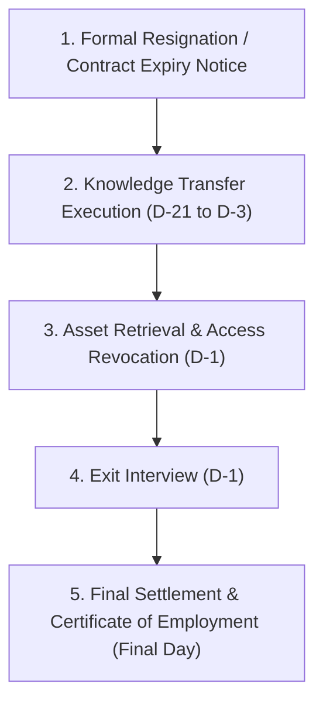

# Offboarding Process & Knowledge Transfer — {{PROJECT_NAME}}

> Canonical document establishing the employee offboarding workflow, knowledge transfer protocol, asset return and access revocation checklist, exit interview questionnaire, and statutory separation settlement for `{{PROJECT_NAME}}`.

---

## 1. Governance & Regulatory Framework

| Parameter | Value |
|---|---|
| **Compliance Standard** | `{{COMPLIANCE_STANDARD}}` |
| **Organization Scale** | `{{EMPLOYEE_SCALE}}` |
| **Notice Period Requirement** | Standard 30 calendar days (or stipulated employment agreement) |
| **Final Sign-off Authority** | `{{DECISION_OWNER}}` |

---

## 2. End-to-End Offboarding Timeline

| Timeline | Milestone | Key Operational Action | Responsible Party |
|---|---|---|---|
| **Day -30** | Official Notification | Written resignation accepted or formal end-of-contract notice issued | Employee & Direct Supervisor |
| **Day -21 to -7** | Knowledge Transfer | Documenting active projects, recorded technical walkthroughs, handover | Employee & Designated Successor |
| **Day -3** | Handover Sign-off | Direct manager verifies and signs off on knowledge transfer checklist | Direct Supervisor |
| **Day -1** | Asset Inspection | Physical check of laptops, accessories, and return of building access passes | IT & Facilities / GA |
| **Day -1** | Exit Interview | Confidential feedback interview exploring employee sentiment and experience | People Ops / HR Team |
| **Final Day** | System De-provisioning | Revocation of digital credentials and settlement of final dues | HR, IT, & Finance |

---

## 3. Knowledge Transfer & Handover Protocol

Every in-flight deliverable and recurring duty must be formally handed over to a designated successor:

| No | In-Flight Project / Module | Current Status | Supporting Docs / Repo Links | Successor Assignee | Verification Status |
|---|---|---|---|---|---|
| 1 | *(Active Project 1)* | *(Completion % / blockers)* | *(Repo / doc link)* | *(Colleague Name)* | [ ] Verified |
| 2 | *(Active Project 2)* | *(Completion % / blockers)* | *(Repo / doc link)* | *(Colleague Name)* | [ ] Verified |
| 3 | *(Recurring Operational SOP)* | *(Cadence / steps)* | *(SOP doc link)* | *(Colleague Name)* | [ ] Verified |

> **Handover Statement:** All operational documentation, architectural context, and running credentials have been fully transitioned and verified by the designated team member.

---

## 4. Asset Return & Access Revocation Checklist

### 4.1. Physical Equipment & Facilities (Return to Operations/IT)
- [ ] Corporate laptop (including power adapter, display dongles, and protective sleeve).
- [ ] External workstation monitors and office equipment *(if applicable)*.
- [ ] Office/building security access card and cabinet keys.
- [ ] Corporate physical credit card and medical insurance cards *(if applicable)*.

### 4.2. Digital Accounts & Access Deprovisioning (Revoked by IT Administrator)
- [ ] Google Workspace / Microsoft 365 enterprise account (email, shared drives, calendar).
- [ ] Version control repositories (GitHub, GitLab, Bitbucket organization seats).
- [ ] Cloud infrastructure and production server access (AWS, GCP, VPS, databases).
- [ ] Internal collaboration tools (Slack, Discord, Microsoft Teams).
- [ ] Project management systems (Jira, Linear, Asana, Notion).

---

## 5. Exit Interview Questionnaire

The exit interview is conducted confidentially to surface candid organizational feedback:

1. **Primary Reasons for Departure:**
   - [ ] External promotion / superior career trajectory.
   - [ ] Compensation, equity, or benefits package.
   - [ ] Personal considerations / family relocation.
   - [ ] Work-life balance or organizational dynamics.
2. **Workplace Culture & Experience:**
   - Aspect of team culture most valued during tenure: `___________________`
   - Primary operational friction encountered: `___________________`
3. **Constructive Advice for Leadership:**
   - Recommended enhancements to workflows or team culture for `{{PROJECT_NAME}}`: `___________________`

---

## 6. Statutory Final Settlement & Employment Closure

1. **Financial Settlement (*Final Pay*):**
   - Accrued, unused statutory annual leave compensation.
   - Pro-rated salary for the final pay period.
   - Severance, service pay, or rights replacement compensation mandated by `{{COMPLIANCE_STANDARD}}`.
2. **Official Documentation Issuance:**
   - Certificate of Employment / Service Letter (*Paklaring*).
   - Tax withholding certification (e.g., Form 1721-A1 or local equivalent).
   - Official reference letter *(if mutually agreed)* endorsed by `{{DECISION_OWNER}}`.
