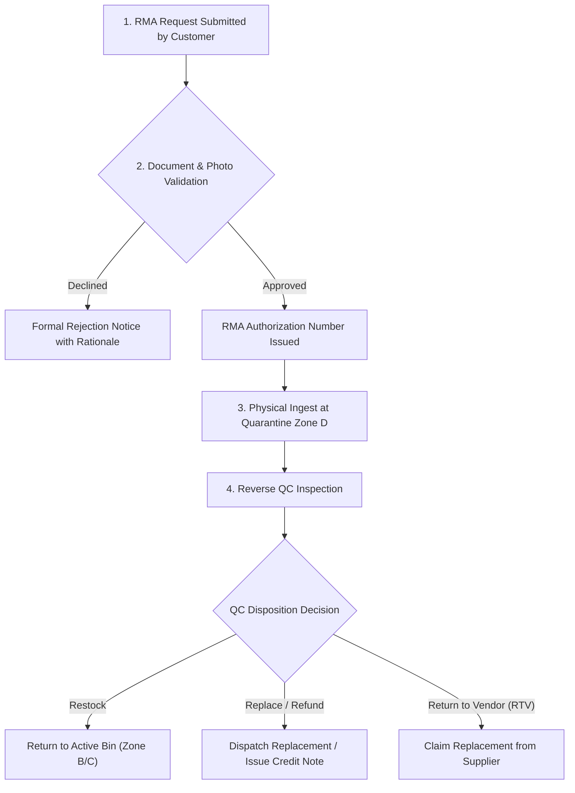

# Return Handling & Logistics Escalation — {{PROJECT_NAME}}

> Canonical document establishing return merchandise authorization (RMA) policies, reverse logistics inspection workflows, freight claims protocols, and dispute escalation matrices for `{{PROJECT_NAME}}`.

---

## 1. Return Merchandise Authorization (RMA) Policy

| Parameter | Value |
|---|---|
| **Return Submission Window** | Maximum 7 calendar days from Proof of Delivery (POD) date |
| **Reverse Logistics Warehouse** | `{{WAREHOUSE_SYSTEM}}` |
| **Return Transport Model** | `{{DELIVERY_MODEL}}` |
| **Special Claim Sign-off Authority** | `{{DECISION_OWNER}}` |

---

## 2. Return Classifications & Evidence Criteria

| Return Category | Acceptance Eligibility | Mandatory Supporting Evidence | Freight Cost Liability |
|---|---|---|---|
| **1. Erroneous Item (Wrong SKU)** | Item delivered differs from confirmed Sales Order | Photographs of product and outer barcode | Company Liability |
| **2. Dead on Arrival (DoA) / Factory Defect** | Immediate functional failure upon unboxing | Video demonstration verifying malfunction | Vendor / Company Liability |
| **3. In-Transit Shipping Damage** | Outer box crushed/breached causing product harm | Photos prior to opening; note on BOL | Carrier Transit Insurance |
| **4. Customer Change of Mind** | Factory seal and packaging completely unbroken | High-resolution image of intact seals | Customer Liability |

---

## 3. End-to-End Reverse Logistics Workflow

| Reverse Stage | Responsible Role | Target Turnaround (SLA) | Document Artifact |
|---|---|---|---|
| **RMA Review & Approval** | Customer Support & Logistics | 24 working hours | RMA Approval Notice |
| **Dock Receiving & Ingest** | Inbound Receiving Admin | Day of freight arrival | Return Receipt Slip |
| **Reverse QC Diagnostic** | Quality Control Inspector | 48 working hours | Physical Inspection Report |
| **Financial Settlement / Reship** | Finance & Fulfillment Team | 3 business days | Credit Note / New Shipping AWB |

---

## 4. Freight Carrier Damage Claim Protocol

When cargo damage occurs during carrier transit:
1. **Evidence Collection:** Photograph all 6 sides of the damaged external carton and affected merchandise.
2. **Delivery Exception Note:** Ensure the carrier delivery driver logs the formal damage exception on the manifest.
3. **Formal Claim Submission:** File the insurance claim via the carrier portal within 24 hours of package delivery.
4. **Settlement Tracking:** Monitor settlement processing until insurance compensation is credited.

---

## 5. Escalation Matrix & Financial Authority Limits

Resolution options map to established organizational authority tiers:

| Claim Valuation Range | Approval Tier | Authorized Resolution Path |
|---|---|---|
| **< $500 USD equivalent** | Warehouse Supervisor / CS Lead | Immediate 1-to-1 replacement or store credit |
| **$500 to $2,500 USD** | Logistics Operations Manager | Full electronic cash refund or invoice credit adjustment |
| **> $2,500 USD** | `{{DECISION_OWNER}}` | Strategic commercial concession, vendor contract penalty, or legal review |

> **Operating Principle:** Swift customer resolution and stock ledger precision remain our twin priorities, upholding financial stewardship across all reverse logistics loops.
