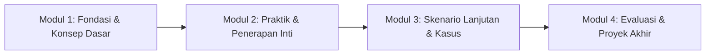

# Silabus & Struktur Kurikulum Modul — {{PROJECT_NAME}}

> Dokumen kanonikal yang menetapkan silabus pembelajaran, struktur modul berjenjang, prasyarat peserta, dan peta capaian pembelajaran untuk `{{PROJECT_NAME}}`.

---

## 1. Profil Program Pendidikan & Pelatihan

| Parameter | Nilai |
|---|---|
| **Format & Model Pelatihan** | `{{TRAINING_TYPE}}` |
| **Profil Peserta Sasaran** | `{{TARGET_LEARNER}}` |
| **Ruang Lingkup Kurikulum** | `{{CURRICULUM_SCOPE}}` |
| **Metode Evaluasi Utama** | `{{ASSESSMENT_METHOD}}` |
| **Penanggung Jawab Kurikulum** | `{{DECISION_OWNER}}` |

---

## 2. Capaian Pembelajaran Program (Learning Outcomes)

Setelah menyelesaikan seluruh rangkaian program `{{PROJECT_NAME}}`, peserta didik diharapkan mampu:
1. **Capaian Kognitif:** Memahami konsep inti, prinsip teoritis, dan terminologi standar dalam lingkup `{{CURRICULUM_SCOPE}}`.
2. **Capaian Praktis:** Mengaplikasikan metodologi dan alat kerja secara mandiri untuk menyelesaikan studi kasus nyata.
3. **Capaian Sintesis & Pemecahan Masalah:** Mengidentifikasi anomali, melakukan troubleshooting, dan merumuskan solusi optimal berbasis data.

---

## 3. Prasyarat & Kebutuhan Awal Peserta

Sebelum mengikuti program, peserta wajib memenuhi kualifikasi awal berikut:
- **Latar Belakang Pengetahuan:** *(cth: Pemahaman dasar logika pemrograman / pengenalan proses bisnis dasar)*.
- **Kesiapan Perangkat & Lingkungan:** *(cth: Laptop RAM minimal 8GB, koneksi internet stabil, izin instalasi software)*.
- **Pre-Test Mandiri:** *(Penyelesaian kuesioner awal atau tes diagnostik untuk penyesuaian materi)*.

---

## 4. Struktur Modul & Silabus Rinci

Kurikulum dibagi menjadi 4 modul progresif:

| Modul | Nama Modul | Durasi | Sasaran Sesi | Topik Utama | Deliverable Peserta |
|---|---|---|---|---|---|
| **Modul 1** | Fondasi & Konsep Dasar | *(X jam / sesi)* | Memahami kerangka konseptual dan arsitektur | Konsep esensial, terminologi, arsitektur dasar | Lembar kerja pemahaman konsep |
| **Modul 2** | Praktik & Penerapan Inti | *(X jam / sesi)* | Mengoperasikan tools dan alur kerja utama | Hands-on lab, simulasi panduan, studi kasus berpemandu | Tugas mandiri lab praktis |
| **Modul 3** | Skenario Lanjutan & Kasus | *(X jam / sesi)* | Menangani kasus kompleks dan optimasi proses | Studi kasus industri, analisis kesalahan, optimasi kinerja | Laporan analisis kasus nyata |
| **Modul 4** | Proyek Akhir & Capstone | *(X jam / sesi)* | Mengintegrasikan seluruh kompetensi secara mandiri | Pengerjaan proyek mandiri, presentasi, sesi tanya jawab | Portofolio proyek akhir teruji |

---

## 5. Peta Dependensi & Jam Pelajaran (JP)

- **Total Beban Pembelajaran:** *(cth: 32 Jam Pelajaran / 4 Minggu Intensif)*.
- **Alokasi Waktu:**
  - 30% Teori & Pemaparan Konseptual interaktif.
  - 50% Praktik Langsung & Hands-on Lab.
  - 20% Evaluasi, Review Proyek, dan Sesi Umpan Balik.
