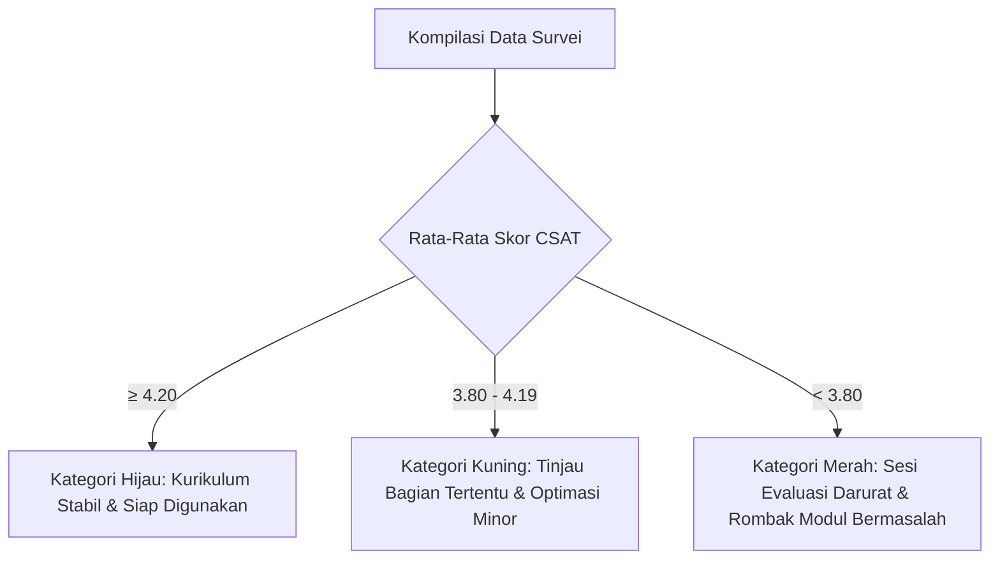

# Umpan Balik Peserta & Siklus Perbaikan Kurikulum — {{PROJECT_NAME}}

> Dokumen kanonikal yang menetapkan instrumen kuesioner evaluasi peserta, metodologi analisis kepuasan belajar, ambang batas perbaikan kualitas, dan siklus iterasi kurikulum untuk `{{PROJECT_NAME}}`.

---

## 1. Tata Kelola Penjaminan Mutu Pembelajaran

| Parameter | Nilai |
|---|---|
| **Format Evaluasi** | Survei Digital Anonim Pasca-Program |
| **Kategori Peserta Sasaran** | `{{TARGET_LEARNER}}` |
| **Batas Target Kepuasan (CSAT)** | Rata-rata Skor Minimal 4.20 / 5.00 (atau ≥ 85%) |
| **Penanggung Jawab Mutu & Revisi** | `{{DECISION_OWNER}}` |

---

## 2. Instrumen Kuesioner Survei Kepuasan (Skala Likert 1–5)

Kuesioner dibagikan secara elektronik menjelang penutupan sesi terakhir:

| Dimensi Evaluasi | Pernyataan Survei | Skala (1–5) | Target Rata-Rata |
|---|---|---|---|
| **Relevansi Materi** | 1. Materi pelatihan selaras dengan kebutuhan pekerjaan nyata saya. | [ ] | ≥ 4.2 |
| | 2. Urutan silabus dan pembagian modul disusun secara logis dan mudah dipahami. | [ ] | ≥ 4.0 |
| **Kinerja Instruktur** | 3. Instruktur menguasai materi secara mendalam dan lugas dalam pemaparan. | [ ] | ≥ 4.3 |
| | 4. Instruktur bersikap interaktif, sabar, dan responsif terhadap pertanyaan peserta. | [ ] | ≥ 4.3 |
| **Materi & Praktik** | 5. Lembar kerja praktik (hands-on lab) membantu memperkuat pemahaman konsep. | [ ] | ≥ 4.2 |
| | 6. Dokumentasi modul dan ringkasan materi mudah dipelajari kembali secara mandiri. | [ ] | ≥ 4.0 |
| **Fasilitas & Platform** | 7. Platform pembelajaran / ruang kelas virtual stabil dan nyaman digunakan. | [ ] | ≥ 4.0 |
| | 8. Koordinasi jadwal dan bantuan teknis selama program berjalan memuaskan. | [ ] | ≥ 4.1 |

> **Skala Penilaian:** 1 = Sangat Tidak Puas | 2 = Tidak Puas | 3 = Cukup | 4 = Puas | 5 = Sangat Puas

---

## 3. Pertanyaan Umpan Balik Kualitatif

1. Topik atau sesi apa yang memberikan manfaat paling berharga bagi pekerjaan Anda?
   > *(Jawaban terbuka peserta)*
2. Topik atau bagian mana yang dirasa paling sulit, membingungkan, atau memerlukan durasi lebih lama?
   > *(Jawaban terbuka peserta)*
3. Saran konkret apa yang ingin Anda sampaikan untuk meningkatkan mutu program berikutnya?
   > *(Jawaban terbuka peserta)*

---

## 4. Analisis Data & Ambang Batas Tindakan Korektif

- **Net Promoter Score (NPS):** "Seberapa besar kemungkinan Anda merekomendasikan pelatihan ini kepada rekan kerja?" (Skala 0–10). Target NPS ≥ +40.
- **Waktu Pelaporan:** Laporan hasil evaluasi wajib dikompilasi maksimal 3 hari kerja setelah penutupan program dan dilaporkan kepada `{{DECISION_OWNER}}`.

---

## 5. Siklus Iterasi Kurikulum Berkelanjutan

Perbaikan kurikulum diimplementasikan secara berkesinambungan lintas angkatan (batch):

1. **Review Pasca-Batch (D+5):** Evaluasi gabungan antara instruktur, tim kurikulum, dan perwakilan peserta.
2. **Pembaruan Modul (D+14):** Penyesuaian slide, perbaikan instruksi lab yang menimbulkan kebingungan, dan pembaruan dataset.
3. **Validasi Kesiapan (D+21):** Uji coba materi baru (*dry run*) sebelum dirilis untuk angkatan berikutnya.
