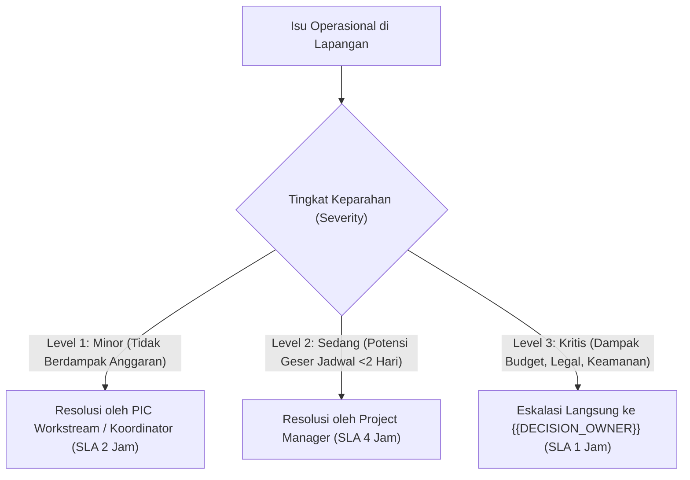

# Pemangku Kepentingan & Matriks RACI — {{PROJECT_NAME}}

> Dokumen kanonikal yang menetapkan pemetaan pemangku kepentingan, matriks tanggung jawab RACI per workstream, ritme komunikasi, dan prosedur eskalasi keputusan untuk `{{PROJECT_NAME}}`.

---

## 1. Konteks Tata Kelola Proyek

| Parameter | Nilai |
|---|---|
| **Pemetaan Pemangku Kepentingan** | `{{STAKEHOLDER_MAP}}` |
| **Pimpinan Proyek (Project Director)** | `{{DECISION_OWNER}}` |
| **Kategori Inisiatif** | `{{PROJECT_TYPE}}` |
| **Prinsip Akuntabilitas** | Satu penanggung jawab mutlak (*Accountable*) untuk setiap deliverable |

---

## 2. Peta Pemangku Kepentingan (Stakeholder Landscape)

| Peran | Pihak Terlibat | Kepentingan Utama | Tingkat Pengaruh |
|---|---|---|---|
| **Project Sponsor / Owner** | `{{DECISION_OWNER}}` | Keberhasilan strategis, kepatuhan anggaran, reputasi merek | Sangat Tinggi |
| **Project Manager (PM)** | Tim Manajemen Proyek | Eksekusi tepat waktu, koordinasi lintas divisi, resolusi blocker | Sangat Tinggi |
| **Tim Acara & Kreatif** | Koordinator Acara & Desain | Kualitas konten rundown, pengalaman peserta, estetika visual | Tinggi |
| **Tim Logistik & Venue** | Koordinator Perlengkapan & Vendor | Kelancaran fasilitas fisik, sound system, konsumsi, transportasi | Tinggi |
| **Mitra & Pihak Eksternal** | Vendor, Sponsor, Tamu VIP, Otoritas Izin | Pemenuhan kontrak kerja, eksposur publik, legalitas acara | Sedang – Tinggi |

---

## 3. Matriks RACI per Workstream Proyek

> **Definisi Peran RACI:**
> **R (Responsible):** Pelaksana tugas yang bertanggung jawab menyelesaikan aktivitas.
> **A (Accountable):** Pengambil keputusan akhir yang memiliki wewenang tunggal menyetujui hasil.
> **C (Consulted):** Ahli materi atau pihak terkait yang dimintai masukan sebelum keputusan dibuat.
> **I (Informed):** Pihak yang diberi pembaruan progres setelah tindakan atau keputusan dieksekusi.

| Workstream & Deliverable Utama | Project Owner | Project Manager | Tim Acara | Tim Logistik | Tim Pemasaran |
|---|---|---|---|---|---|
| **Konsep Acara, Tema, & Keynote Speakers** | **A** | **C** | **R** | **I** | **C** |
| **Alokasi Anggaran & Negosiasi Vendor** | **A** | **R** | **C** | **C** | **I** |
| **Perizinan Tempat & Keamanan Venue** | **I** | **A** | **I** | **R** | **I** |
| **Registrasi Peserta & Promosi Kampanye** | **I** | **A** | **C** | **I** | **R** |
| **Eksekusi Rundown & Gladi Resik (Hari-H)** | **I** | **A** | **R** | **R** | **I** |
| **Laporan Evaluasi Pasca-Acara (LPJ)** | **A** | **R** | **C** | **C** | **C** |

---

## 4. Ritme Komunikasi & Pertemuan Berkala

1. **Sprint Planning / Weekly Coordination:** Rapat mingguan 45 menit untuk meninjau status milestone dan blocker lintas workstream.
2. **Daily Standup (H-7 hingga Hari-H):** Sinkronisasi kilat 15 menit setiap pagi untuk pengecekan kesiapan teknis detail.
3. **War Room & Command Center (Hari-H):** Ruang kendali sentral via radio komunikasi (HT) dan kanal instan darurat untuk koordinasi real-time.

---

## 5. Matriks Jalur Eskalasi Masalah

Ketika terjadi deviasi jadwal, pembengkakan biaya, atau insiden operasional:

