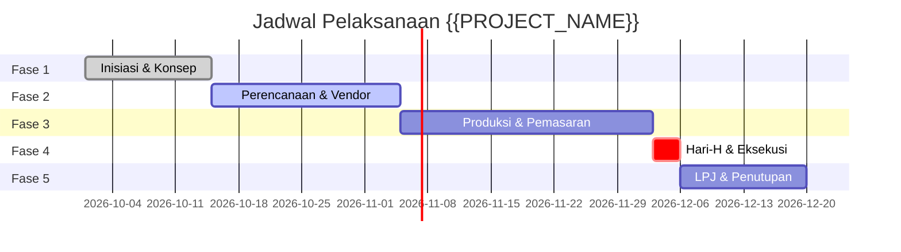

# Rencana Milestone & Alokasi Anggaran — {{PROJECT_NAME}}

> Dokumen kanonikal yang menetapkan jadwal tahapan proyek (milestone schedule), rincian alokasi anggaran biaya, pelacakan deviasi keuangan, dan prosedur permohonan perubahan (*change request*) untuk `{{PROJECT_NAME}}`.

---

## 1. Parameter Waktu & Keuangan

| Parameter | Nilai |
|---|---|
| **Horison Timeline Proyek** | `{{TIMELINE_HORIZON}}` |
| **Kategori Proyek** | `{{PROJECT_TYPE}}` |
| **Alokasi Cadangan Kontinjensi** | 10% – 15% dari total anggaran disetujui |
| **Otoritas Persetujuan Anggaran** | `{{DECISION_OWNER}}` |

---

## 2. Jadwal Milestone & Deliverable Proyek

Proyek dijalankan melalui 5 fase terstruktur:

| Fase Proyek | Kegiatan Kunci | Target Tanggal | Kriteria Selesai (Milestone Gate) | Status |
|---|---|---|---|---|
| **Fase 1: Inisiasi** | Pengesahan piagam proyek & penetapan tim inti | `YYYY-MM-DD` | Project charter ditandatangani `{{DECISION_OWNER}}` | [ ] Selesai |
| **Fase 2: Perencanaan** | Finalisasi kontrak venue, vendor utama, & perizinan | `YYYY-MM-DD` | Kontrak vendor tuntas, izin lokasi terbit | [ ] Dalam Proses |
| **Fase 3: Pra-Acara** | Kampanye pendaftaran peserta & persiapan teknis rundown | `YYYY-MM-DD` | Kuota peserta 100% terpenuhi, materi visual final | [ ] Belum Mulai |
| **Fase 4: Eksekusi** | Gladi resik menyeluruh dan pelaksanaan acara (Hari-H) | `YYYY-MM-DD` | Seluruh mata acara berjalan sesuai rundown aman | [ ] Belum Mulai |
| **Fase 5: Penutupan** | Pelunasan tagihan, evaluasi CSAT, & penyusunan LPJ | `YYYY-MM-DD` | LPJ dan laporan keuangan disetujui | [ ] Belum Mulai |

---

## 3. Rencana Alokasi Anggaran Biaya (Budget Plan)

| Pos Pembiayaan | Deskripsi & Alokasi Kebutuhan | Anggaran (Rp) | Realisasi (Rp) | Varian (%) | Status |
|---|---|---|---|---|---|
| **1. Venue & Fasilitas** | Sewa gedung, panggung, sound system, pencahayaan | [Nominal] | [Nominal] | [ % ] | Sesuai |
| **2. Produksi & Kreatif** | Desain visual, backdrop, ID card, merchandise, plakat | [Nominal] | [Nominal] | [ % ] | Sesuai |
| **3. Konsumsi & Akomodasi** | Katering peserta, coffee break, akomodasi VIP/pembicara | [Nominal] | [Nominal] | [ % ] | Sesuai |
| **4. Pemasaran & Promosi** | Iklan digital, promosi media, cetak spanduk | [Nominal] | [Nominal] | [ % ] | Sesuai |
| **5. Operasional & Keamanan** | Honor panitia lapangan, tim medis, izin aparat keamanan | [Nominal] | [Nominal] | [ % ] | Sesuai |
| **6. Dana Kontinjensi (10%)** | Cadangan risiko darurat & pengeluaran tak terduga | [Nominal] | [Nominal] | [ % ] | Cadangan |
| **Total Anggaran** | | **[Total]** | **[Total]** | **[ % ]** | |

---

## 4. Prosedur Permohonan Perubahan (Change Request Procedure)

Apabila tim mengidentifikasi kebutuhan pergeseran tanggal milestone atau realokasi dana:
1. **Penyusunan Formulir CR:** Ajukan formulir mencantumkan alasan deviasi, analisis dampak risiko, dan opsi kompensasi.
2. **Review Teknis & Keuangan:** Tim Manajemen Proyek menghitung dampak bersih terhadap jadwal akhir dan margin anggaran.
3. **Persetujuan Otoritas:** Perubahan hanya sah bila disetujui secara tertulis oleh `{{DECISION_OWNER}}`.
