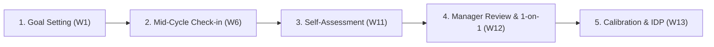

# Siklus Evaluasi Kinerja & Matriks Kompetensi — {{PROJECT_NAME}}

> Dokumen kanonikal yang menetapkan siklus evaluasi kinerja berkala, matriks kompetensi per jenjang jabatan, template formulir penilaian, dan panduan sesi tinjauan 1-on-1 untuk `{{PROJECT_NAME}}`.

---

## 1. Konfigurasi Evaluasi Kinerja

| Parameter | Nilai |
|---|---|
| **Frekuensi Siklus Kinerja** | `{{PERFORMANCE_CYCLE}}` |
| **Cakupan Organisasi** | `{{EMPLOYEE_SCALE}}` |
| **Pimpinan Kalibrasi & Keputusan** | `{{DECISION_OWNER}}` |
| **Kerangka Sasaran Utama** | Kombinasi OKR / KPI (Deliverables) & Penilaian Kompetensi Perilaku |

---

## 2. Kalender & Alur Siklus Evaluasi

Setiap siklus `{{PERFORMANCE_CYCLE}}` dijalankan melalui 5 tahapan berurutan:

| Tahap | Aktivitas Utama | Pelaksana | Output Wajib |
|---|---|---|---|
| **1. Goal Setting** | Penetapan target OKR/KPI individu selaras dengan sasaran `{{PROJECT_NAME}}` | Karyawan & Atasan Langsung | Dokumen target kerja disetujui |
| **2. Mid-Cycle Check-in** | Tinjauan kemajuan tengah periode, identifikasi hambatan, dan penyesuaian | Karyawan & Atasan Langsung | Catatan pembaruan progres & mitigasi |
| **3. Self-Assessment** | Evaluasi mandiri oleh karyawan atas deliverable dan kompetensi | Karyawan | Draft form evaluasi mandiri |
| **4. Manager Review & 1-on-1** | Penilaian oleh atasan langsung dan dialog tatap muka terstruktur | Karyawan & Atasan Langsung | Lembar penilaian akhir atasan |
| **5. Calibration & IDP** | Sidang kalibrasi lintas divisi dan penyusunan Rencana Pengembangan Individu | Komite Kalibrasi & HR | Skor resmi & Individual Development Plan |

---

## 3. Matriks Kompetensi per Jenjang Jabatan

Matriks berikut mendefinisikan ekspektasi perilaku dan keahlian di setiap level:

| Jenjang Jabatan | Kompetensi Teknis & Eksekusi | Problem Solving & Inisiatif | Komunikasi & Kolaborasi | Kepemimpinan & Pengaruh |
|---|---|---|---|---|
| **Junior / Associate** | Melaksanakan tugas terdefinisi dengan bimbingan reguler; akurasi tinggi | Mengidentifikasi isu operasional dan melaporkan segera dengan opsi awal | Komunikasi transparan, terbuka menerima masukan konstruktif | Mengelola waktu dan tanggung jawab pribadi secara disiplin |
| **Mid-Level** | Eksekusi mandiri end-to-end pada lingkup modul; mematuhi standar mutu | Memecahkan masalah tanpa supervisi intensif; optimasi proses | Kolaborasi efektif lintas fungsi; mendokumentasikan alur kerja | Membimbing anggota tim junior; aktif berbagi pengetahuan |
| **Senior** | Menangani sistem kompleks; mengantisipasi risiko teknis dan operasional | Analisis akar masalah (root cause analysis); desain solusi terstruktur | Presentasi persuasif ke pemangku kepentingan; negosiasi solutif | Mentoring tim; mengarahkan praktik terbaik (*best practices*) |
| **Lead / Manager** | Menetapkan strategi teknis/operasional; menyelaraskan dengan visi bisnis | Pengambilan keputusan strategis di bawah ketidakpastian tinggi | Penyelarasan ekspektasi eksekutif dan komunikasi krisis | Mengembangkan talenta tim, memfasilitasi pertumbuhan karir anggota |

---

## 4. Formulir Penilaian Kinerja

Skor akhir dihitung dari kombinasi Pencapaian Hasil Kerja (60%) dan Kompetensi Perilaku (40%):

### 4.1. Bagian A: Pencapaian Target OKR / KPI (Bobot 60%)
| No | Sasaran Kerja / Key Result | Target Metrik | Realisasi | Pencapaian (%) | Skor Tertimbang |
|---|---|---|---|---|---|
| 1 | *(Sasaran utama 1)* | *(Angka / Persentase)* | *(Hasil aktual)* | *(% capaian)* | [ ] |
| 2 | *(Sasaran utama 2)* | *(Angka / Persentase)* | *(Hasil aktual)* | *(% capaian)* | [ ] |
| 3 | *(Sasaran pendukung 3)* | *(Angka / Persentase)* | *(Hasil aktual)* | *(% capaian)* | [ ] |
| **Subtotal Bagian A** | | | | | **[Skor A]** |

### 4.2. Bagian B: Evaluasi Kompetensi & Core Values (Bobot 40%)
| No | Aspek Kompetensi | Indikator Perilaku | Skor (1–5) | Bukti Perilaku Nyata |
|---|---|---|---|---|
| 1 | Kualitas & Ketepatan Kerja | Konsistensi deliverable bebas cacat dan tepat waktu | [ ] | *(Deskripsi contoh kasus)* |
| 2 | Kolaborasi Lintas Tim | Membantu rekan kerja dan menyelaraskan solusi | [ ] | *(Deskripsi contoh kasus)* |
| 3 | Kepemilikan & Integritas | Tanggung jawab penuh atas hasil kerja dan kepatuhan | [ ] | *(Deskripsi contoh kasus)* |
| 4 | Inovasi & Pembelajaran Berkelanjutan | Inisiatif perbaikan proses dan adopsi alat bantu baru | [ ] | *(Deskripsi contoh kasus)* |
| **Subtotal Bagian B** | | | | **[Skor B]** |

---

## 5. Panduan Sesi Review 1-on-1 & Rencana Pengembangan (IDP)

1. **Prinsip Dialog SBI (*Situation-Behavior-Impact*):**
   - **Situation:** Jelaskan konteks atau situasi spesifik di mana tindakan terjadi.
   - **Behavior:** Gambarkan perilaku nyata yang diamati tanpa menghakimi personal.
   - **Impact:** Uraikan dampak positif atau kerugian yang ditimbulkan terhadap tim/organisasi.
2. **Individual Development Plan (IDP):**
   - Target peningkatan skill untuk siklus berikutnya: `___________________`
   - Pelatihan / sertifikasi yang disepakati: `___________________`
   - Proyek penugasan untuk melatih kompetensi baru: `___________________`
