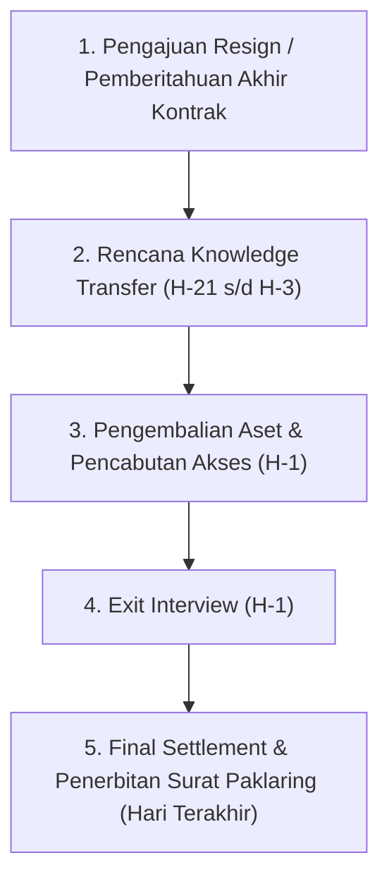

# Proses Offboarding & Serah Terima Pengetahuan — {{PROJECT_NAME}}

> Dokumen kanonikal yang menetapkan alur offboarding karyawan, prosedur transfer pengetahuan, checklist pengembalian aset dan pencabutan akses, template exit interview, serta administrasi akhir sesuai `{{COMPLIANCE_STANDARD}}` untuk `{{PROJECT_NAME}}`.

---

## 1. Konteks Regulasi & Kebijakan

| Parameter | Nilai |
|---|---|
| **Regulasi Acuan** | `{{COMPLIANCE_STANDARD}}` |
| **Skala Organisasi** | `{{EMPLOYEE_SCALE}}` |
| **Masa Pemberitahuan (Notice Period)** | Standar 30 hari kalender (atau sesuai perjanjian kerja) |
| **Otoritas Persetujuan Akhir** | `{{DECISION_OWNER}}` |

---

## 2. Alur Proses Offboarding End-to-End

| Hari Kerja | Tahapan | Aktivitas Utama | Penanggung Jawab |
|---|---|---|---|
| **H-30** | Notifikasi Resmi | Penerimaan surat pengunduran diri tertulis atau pemberitahuan berakhirnya kontrak | Karyawan & Atasan Langsung |
| **H-21 s/d H-7** | Knowledge Transfer | Dokumentasi proyek berjalan, sesi walkthrough teknis, dan serah terima tugas | Karyawan & Rekan Pengganti |
| **H-3** | Verifikasi Handover | Atasan langsung menandatangani formulir kelengkapan transfer pengetahuan | Atasan Langsung |
| **H-1** | Inventarisasi Aset | Pemeriksaan fisik laptop, aksesori, dan pengembalian kartu akses fasilitas | Tim IT & General Affairs |
| **H-1** | Exit Interview | Sesi wawancara tertutup mengenai pengalaman kerja dan umpan balik konstruktif | Tim HR People Ops |
| **Hari Terakhir** | Final Clearance | Pencabutan seluruh akses sistem digital dan penyelesaian hak finansial terakhir | HR, IT, & Finance |

---

## 3. Prosedur Knowledge Transfer & Handover Deliverable

Setiap tugas dan tanggung jawab yang sedang berjalan wajib diserahterimakan kepada personil pengganti:

| No | Modul / Proyek Berjalan | Status Terakhir | Dokumen / Repo Pendukung | Personil Penerima Serah Terima | Status Verifikasi |
|---|---|---|---|---|---|
| 1 | *(Nama proyek 1)* | *(Persentase / blocker)* | *(Link repo / drive)* | *(Nama rekan)* | [ ] Disetujui |
| 2 | *(Nama proyek 2)* | *(Persentase / blocker)* | *(Link repo / drive)* | *(Nama rekan)* | [ ] Disetujui |
| 3 | *(SOP harian / recurring)* | *(Jadwal rutin)* | *(Link dokumen SOP)* | *(Nama rekan)* | [ ] Disetujui |

> **Pernyataan Serah Terima:** Seluruh dokumentasi, instruksi operasional, dan konteks proyek telah dijelaskan dan dapat dilanjutkan tanpa hambatan oleh rekan pengganti.

---

## 4. Checklist Pengembalian Aset & Pencabutan Akses

### 4.1. Perangkat Keras & Fasilitas Fisik (Diserahkan ke GA/IT)
- [ ] Laptop korporat (beserta charger, mouse, dan tas pelindung).
- [ ] Monitor eksternal dan perlengkapan meja kerja kantor *(jika ada)*.
- [ ] Kartu akses gedung/kantor dan kunci laci/loker.
- [ ] Kartu nama fisik dan kartu asuransi kesehatan *(bila berlaku)*.

### 4.2. Akses Akun & Kredensial Digital (Dicabut oleh IT Administrator)
- [ ] Akun Google Workspace / Microsoft 365 (email, drive, calendar).
- [ ] Akun GitHub / GitLab / Bitbucket repositori kode.
- [ ] Kredensial akses cloud/server (AWS, GCP, VPS, database).
- [ ] Akses alat komunikasi internal (Slack, Discord, Teams).
- [ ] Akses sistem manajemen tugas (Jira, Linear, Trello, Notion).

---

## 5. Template Formulir Exit Interview

Sesi wawancara keluar diselenggarakan secara rahasia untuk mendorong masukan objektif:

1. **Alasan Utama Pengunduran Diri:**
   - [ ] Peluang karir / promosi eksternal yang lebih baik.
   - [ ] Penyesuaian kompensasi & benefit.
   - [ ] Alasan pribadi / keluarga / relokasi tempat tinggal.
   - [ ] Beban kerja atau dinamika kepemimpinan tim.
2. **Evaluasi Terhadap Lingkungan Kerja & Budaya:**
   - Aspek budaya yang paling diapresiasi selama bekerja: `___________________`
   - Hambatan terbesar yang dirasakan dalam mencapai produktivitas optimal: `___________________`
3. **Umpan Balik untuk Manajemen & Tim:**
   - Saran konkret untuk perbaikan sistem kerja bagi `{{PROJECT_NAME}}`: `___________________`

---

## 6. Administrasi Akhir & Hak Finansial

1. **Penyelesaian Hak Finansial (*Final Settlement*):**
   - Kompensasi sisa cuti tahunan yang belum gugur.
   - Gaji prorata bulan berjalan.
   - Uang kompensasi / pesangon sesuai ketentuan yang diwajibkan oleh `{{COMPLIANCE_STANDARD}}`.
2. **Penerbitan Dokumen Resmi:**
   - Surat Keterangan Pengalaman Kerja (*Paklaring*).
   - Formulir bukti pemotongan pajak PPh 21 (Form 1721-A1).
   - Surat referensi kerja resmi *(jika disepakati)* disahkan oleh `{{DECISION_OWNER}}`.
