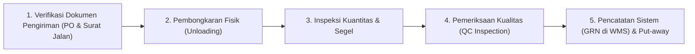

# Prosedur Penerimaan Barang & Kontrol Kualitas — {{PROJECT_NAME}}

> Dokumen kanonikal yang menetapkan alur penerimaan barang masuk (inbound), protokol inspeksi kualitas (QC), dan penanganan ketidaksesuaian barang (Non-Conformance Report) untuk `{{PROJECT_NAME}}`.

---

## 1. Profil Operasional Rantai Pasok

| Parameter | Nilai |
|---|---|
| **Ruang Lingkup Operasi** | `{{SUPPLY_CHAIN_SCOPE}}` |
| **Metode Valuasi Inventori** | `{{INVENTORY_METHOD}}` |
| **Sistem Gudang / WMS** | `{{WAREHOUSE_SYSTEM}}` |
| **Model Distribusi** | `{{DELIVERY_MODEL}}` |
| **Penanggung Jawab Gudang & Logistik** | `{{DECISION_OWNER}}` |

---

## 2. Alur Operasional Penerimaan Barang Masuk (Inbound SOP)

Setiap pengiriman barang dari pemasok wajib melalui 5 tahapan verifikasi:

| Tahap | Aktivitas Utama | Dokumen Acuan | Petugas Bertanggung Jawab | Toleransi Waktu |
|---|---|---|---|---|
| **1. Dokumen Verifikasi** | Pencocokan Surat Jalan fisik terhadap Purchase Order (PO) sistem | PO & Surat Jalan Asli | Admin Gudang | Maks 30 menit |
| **2. Unloading & Staging** | Penurunan koli barang ke area penerimaan (*receiving staging*) | Manifest Pengiriman | Tim Bongkar Muat | Sesuai volume armada |
| **3. Hitung Kuantitas** | Penghitungan fisik kemasan luar, kondisi segel, dan kode batch | Tally Sheet Penerimaan | Checker Gudang | Hari kedatangan |
| **4. QC Sampling** | Pemeriksaan mutu fisik, tanggal kadaluarsa, dan uji fungsional | Form Inspeksi QC (AQL) | Petugas QC Inbound | Maks 4 jam kerja |
| **5. GRN & Put-away** | Penerbitan Goods Receipt Note (GRN) dan penempatan ke rak penyimpanan | GRN & Label Lokasi Rak | Operator Forklift / Staf | Hari yang sama (D+0) |

---

## 3. Protokol Inspeksi Kontrol Kualitas (QC Protocol)

Inspeksi barang menggunakan pendekatan *Acceptable Quality Level* (AQL) standar:

| Kategori Barang | Metode Pengujian QC | Ukuran Sampel (Sampling) | Batas Cacat Maksimal (AQL) |
|---|---|---|---|
| **Bahan Baku / Komponen Kritis** | Uji spesifikasi teknis, dimensi, toleransi fungsional | 10% per lot kedatangan | 0% cacat kritis (Zero Tolerance) |
| **Barang Jadi / Retail Goods** | Pemeriksaan visual kemasan, barcode, dan fungsi dasar | Sampel acak (ANSI/ASQ Z1.4 Level II) | Cacat mayor maks 1.5%, minor maks 4.0% |
| **Material Kemasan / Pembantu** | Uji ketahanan, kebersihan, dan kesesuaian cetakan | 5 sampel per palet | Maks 2.5% |

---

## 4. Penanganan Ketidaksesuaian & Laporan NCR (Non-Conformance Report)

Apabila ditemukan kerusakan, ketidaksesuaian jumlah, atau kegagalan uji QC:

1. **Karantina Fisik Segera:** Pasang label `REJECT / QUARANTINE` berwarna merah dan pindahkan barang ke Area Karantina.
2. **Penerbitan Laporan NCR:** Admin QC menerbitkan dokumen NCR dalam waktu maksimal 2 jam setelah temuan.
3. **Pemberitahuan Pemasok:** Tim pengadaan menginformasikan kepada pemasok dalam waktu maksimal 24 jam dengan melampirkan:
   - Foto bukti fisik kerusakan atau kecacatan item.
   - Salinan Surat Jalan dan PO terkait.
   - Berita Acara Kerusakan / Ketidaksesuaian ditandatangani pengemudi kurir.
4. **Opsi Resolusi:**
   - **Retur Penuh:** Pemasok mengganti seluruh pengiriman barang rusak.
   - **Penerimaan Sebagian (Partial Receipt):** Penerimaan item yang lolos uji saja dengan pemotongan nilai tagihan (Invoice deduction).
   - **Persetujuan Khusus (Concession):** Persetujuan pemakaian khusus hanya dengan otorisasi tertulis `{{DECISION_OWNER}}`.
