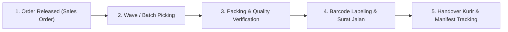

# Pemenuhan Pesanan & Pengiriman Logistik — {{PROJECT_NAME}}

> Dokumen kanonikal yang menetapkan alur pemenuhan pesanan (order fulfillment), standar pengepakan muatan, koordinasi mitra pengiriman, dan pelacakan pengiriman (Proof of Delivery) untuk `{{PROJECT_NAME}}`.

---

## 1. Konfigurasi Operasional Outbound

| Parameter | Nilai |
|---|---|
| **Model Distribusi & Pengiriman** | `{{DELIVERY_MODEL}}` |
| **Sistem Gudang Terpadu** | `{{WAREHOUSE_SYSTEM}}` |
| **Cakupan Rantai Pasok** | `{{SUPPLY_CHAIN_SCOPE}}` |
| **Target Fulfillment SLA (Same-Day Dispatch)** | Pesanan masuk sebelum pukul 14:00 WIB wajib diserahkan ke kurir di hari yang sama |
| **Pimpinan Operasional Distribusi** | `{{DECISION_OWNER}}` |

---

## 2. Alur Pemenuhan Pesanan (Fulfillment SOP)

Proses pemenuhan muatan dijalankan melalui alur terstandarisasi:

| Tahapan | Aktivitas Utama | Kriteria Keberhasilan | Waktu Proses |
|---|---|---|---|
| **1. Order Release** | Verifikasi pembayaran dan pemotongan stok pada `{{WAREHOUSE_SYSTEM}}` | Status pesanan menjadi `READY_TO_PICK` | Otomatis |
| **2. Wave Picking** | Pengambilan barang dari rak bin sesuai rute optimal daftar picking | Akurasi SKU 100% menggunakan barcode scanner | 10–15 menit per batch |
| **3. Packing & QC** | Pengecekan fisik kesesuaian item dan pembungkusan protektif | Tidak ada item tertinggal atau salah tipe | 5–8 menit per koli |
| **4. Shipping Label** | Pencetakan label pengiriman (AWB) dan Surat Jalan rangkap 3 | Barcode terbaca jelas oleh pemindai kurir | 2 menit |
| **5. Dispatch & Manifest** | Penyerahan fisik koli ke armada/kurir disertai penandatanganan manifest | Manifest bertanda tangan dan nomor AWB terinput | Sesuai jadwal pickup |

---

## 3. Standar Pengepakan & Keamanan Barang

Setiap koli kemasan wajib memenuhi standar proteksi transit:
- **Kemasan Luar:** Kardus *corrugated* berlapis ganda (double wall) dengan kekuatan menahan beban tumpuk minimal 5 lapis.
- **Bahan Pengisi (Void Filler):** Penggunaan *bubble wrap*, bantalan udara (*air pillow*), atau kertas pelindung untuk mencegah goncangan.
- **Segel Keamanan:** Lakban bermerek (*branded security tape*) di seluruh sambungan karton untuk mendeteksi indikasi pembobolan paket.
- **Tanda Peringatan Khusus:** Penempelan stiker `FRAGILE / JANGAN DIBANTING` atau `THIS SIDE UP` pada barang sensitif atau rentan pecah.

---

## 4. Matriks SLA Pengiriman Berdasarkan Zona

Target durasi pengiriman di bawah `{{DELIVERY_MODEL}}`:

| Wilayah / Zona Pengiriman | Estimasi Durasi Transit (SLA) | Kurir / Moda Transportasi | Batas Keterlambatan Kritis |
|---|---|---|---|
| **Zona 1 (Jabodetabek / Dalam Kota)** | Same-Day / Next-Day (H+1) | Armada Internal / Kurir Instan | > 24 jam dari jadwal |
| **Zona 2 (Pulau Jawa - Antar Kota)** | 1–3 Hari Kerja (H+2) | Kurir Darat Reguler / Truk LTL | > 3 hari kerja |
| **Zona 3 (Luar Pulau Jawa - Kota Utama)** | 2–4 Hari Kerja (H+3) | Kargo Udara / Kurir Ekspres | > 5 hari kerja |
| **Zona 4 (Wilayah Terpencil / Pelosok)** | 5–8 Hari Kerja (H+7) | Ekspedisi Multi-Moda Laut & Darat | > 10 hari kerja |

---

## 5. Pelacakan Status Pengiriman & Bukti Penerimaan (POD)

1. **Sinkronisasi Resi Otomatis:** Nomor pelacakan (tracking number / AWB) dikirimkan otomatis ke pemesan via email/notifikasi dalam 1 jam pasca-pickup.
2. **Proof of Delivery (POD):**
   - Bukti penerimaan digital berupa foto paket di lokasi penerima dan tanda tangan penerima asli.
   - Arsip Surat Jalan fisik kembali (*copy balikan*) diverifikasi oleh admin logistik dalam waktu maksimal 7 hari kerja.
3. **Penanganan Paket Hilang atau Rusak Transit:**
   - Klaim asuransi pengiriman diajukan dalam waktu 1x24 jam setelah notifikasi anomali.
   - Pengiriman paket pengganti darurat dapat diprioritaskan atas persetujuan `{{DECISION_OWNER}}`.
