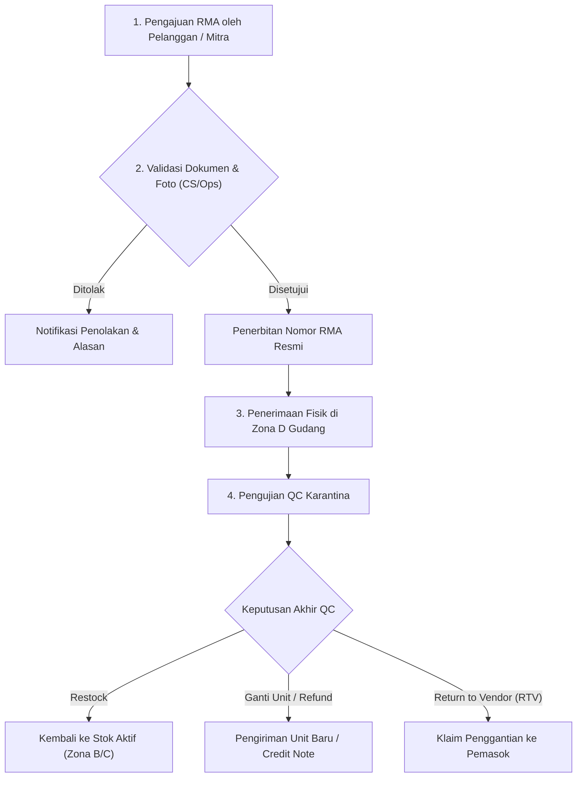

# Penanganan Retur Barang & Prosedur Eskalasi — {{PROJECT_NAME}}

> Dokumen kanonikal yang menetapkan kebijakan otorisasi pengembalian barang (RMA), alur inspeksi barang retur, prosedur klaim kerusakan pengiriman, dan jalur eskalasi sengketa untuk `{{PROJECT_NAME}}`.

---

## 1. Kebijakan Otorisasi Retur (RMA Policy)

| Parameter | Nilai |
|---|---|
| **Batas Waktu Pengajuan Retur** | Maksimal 7 hari kalender sejak tanggal Proof of Delivery (POD) |
| **Sistem Gudang Pengembalian** | `{{WAREHOUSE_SYSTEM}}` |
| **Model Pengangkutan Retur** | `{{DELIVERY_MODEL}}` |
| **Otoritas Persetujuan Klaim Khusus** | `{{DECISION_OWNER}}` |

---

## 2. Kategori Alasan Retur & Persyaratan Bukti

| Kategori Retur | Kriteria Penerimaan | Bukti Wajib | Beban Biaya Ongkir |
|---|---|---|---|
| **1. Salah Kirim Barang (Wrong SKU)** | Ketidaksesuaian nomor part/SKU dengan dokumen pesanan | Foto produk & barcode kemasan fisik | Tanggungan Perusahaan |
| **2. Cacat Pabrik / DoA (Dead on Arrival)** | Produk gagal fungsi saat pertama kali dinyalakan/digunakan | Video bukti kegagalan fungsi | Tanggungan Pemasok / Perusahaan |
| **3. Kerusakan Akibat Ekspedisi** | Kemasan luar hancur/basah/robek yang merusak produk | Foto sebelum dibuka & catatan tertulis pada resi | Klaim Asuransi Kurir |
| **4. Pembatalan Pelanggan** | Kemasan segel pabrik utuh dan belum pernah dibuka | Foto kondisi segel utuh dan mulus | Tanggungan Pelanggan |

---

## 3. Alur Penanganan Retur End-to-End

| Tahapan Operasional | Penanggung Jawab | Durasi Maksimal (SLA) | Output Dokumen |
|---|---|---|---|
| **Validasi Pengajuan RMA** | Customer Service & Logistik | 24 jam kerja | Nomor Tiket RMA |
| **Penerimaan Fisik Gudang** | Admin Gudang Inbound | Hari kedatangan paket | Tanda Terima Paket Retur |
| **Pemeriksaan QC Retur** | Tim Kontrol Kualitas (QC) | 48 jam kerja | Berita Acara Pemeriksaan Fisik (BAPF) |
| **Penyelesaian Finansial / Penggantian** | Tim Keuangan & Fulfillment | 3 hari kerja | Credit Note / Resi Pengiriman Baru |

---

## 4. Prosedur Klaim Kerusakan ke Mitra Ekspedisi

Apabila kerusakan terbukti terjadi selama transit kurir:
1. **Pengumpulan Bukti Kerusakan:** Dokumentasikan foto kemasan luar dari 4 sudut dan kondisi produk yang rusak.
2. **Pencatatan Berita Acara Ekspedisi:** Buat laporan tertulis bersama pengemudi/perwakilan kurir di lokasi.
3. **Pengajuan Klaim Asuransi:** Ajukan klaim resmi melalui portal ekspedisi maksimal 2x24 jam sejak paket tiba.
4. **Penyelesaian Klaim:** Pantau pencairan ganti rugi asuransi hingga dana masuk ke rekening penampung.

---

## 5. Matriks Jalur Eskalasi & Batas Otorisasi

Penetapan solusi retur mengikuti matriks limit kewenangan finansial:

| Nilai Nominal Retur | Level Otorisasi | Opsi Resolusi yang Diizinkan |
|---|---|---|
| **< Rp 5.000.000,-** | Supervisor Gudang / CS Lead | Penggantian barang langsung (*1-to-1 replacement*) atau voucher kredit |
| **Rp 5.000.000,- s/d Rp 25.000.000,-** | Manajer Operasional Logistik | Pengembalian dana tunai (*cash refund*) atau penyesuaian invoice tagihan |
| **> Rp 25.000.000,-** | `{{DECISION_OWNER}}` | Keputusan komersial strategis, negosiasi legal, atau penalti kontrak pemasok |

> **Prinsip Layanan:** Kepuasan mitra dan integritas stok gudang adalah prioritas utama dalam penyelesaian retur tanpa mengorbankan akuntabilitas keuangan organisasi.
